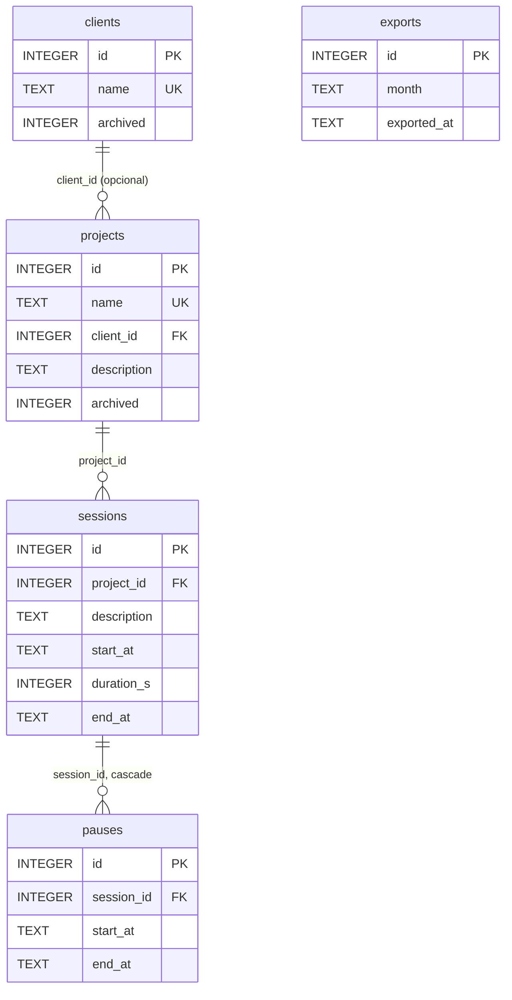

# Persistencia

`db.py` define la interfaz `Store` y su única implementación, `SqliteStore`. Es el único módulo que escribe SQL.

## Esquema



```sql
CREATE TABLE clients (
    id       INTEGER PRIMARY KEY,
    name     TEXT    NOT NULL UNIQUE,
    archived INTEGER NOT NULL DEFAULT 0 CHECK (archived IN (0, 1))
);

CREATE TABLE projects (
    id          INTEGER PRIMARY KEY,
    name        TEXT    NOT NULL UNIQUE,
    client_id   INTEGER REFERENCES clients(id),
    description TEXT    NOT NULL DEFAULT '',
    archived    INTEGER NOT NULL DEFAULT 0 CHECK (archived IN (0, 1))
);

CREATE TRIGGER project_client_immutable
BEFORE UPDATE OF client_id ON projects
WHEN OLD.client_id IS NOT NEW.client_id
BEGIN
    SELECT RAISE(ABORT, 'project client is immutable');
END;

CREATE TABLE sessions (
    id          INTEGER PRIMARY KEY,
    project_id  INTEGER NOT NULL REFERENCES projects(id),
    description TEXT    NOT NULL DEFAULT '',
    start_at    TEXT    NOT NULL,
    duration_s  INTEGER NOT NULL CHECK (duration_s > 0),
    end_at      TEXT,
    CHECK (end_at IS NULL OR end_at >= start_at)
);
CREATE UNIQUE INDEX one_active ON sessions((1)) WHERE end_at IS NULL;
CREATE INDEX sessions_start ON sessions(start_at);

CREATE TABLE pauses (
    id         INTEGER PRIMARY KEY,
    session_id INTEGER NOT NULL REFERENCES sessions(id) ON DELETE CASCADE,
    start_at   TEXT    NOT NULL,
    end_at     TEXT,
    CHECK (end_at IS NULL OR end_at >= start_at)
);
CREATE UNIQUE INDEX one_open_pause ON pauses(session_id) WHERE end_at IS NULL;

CREATE TABLE exports (
    id          INTEGER PRIMARY KEY,
    month       TEXT NOT NULL,
    exported_at TEXT NOT NULL
);
CREATE INDEX exports_month ON exports(month);
```

### Detalles

**`one_active`.** Un índice único sobre la expresión constante `(1)`, parcial a `end_at IS NULL`: todas las sesiones abiertas tendrían la misma clave, así que puede existir una sola. Las cerradas no entran en el índice. `one_open_pause` aplica la misma idea por sesión.

**Fechas.** `start_at`, `end_at` y `exported_at` son texto ISO-8601 en UTC con resolución de segundos, por ejemplo `2026-11-09T13:00:00+00:00` (`to_db`/`from_db`). Al tener todas el mismo formato y offset, el orden lexicográfico coincide con el cronológico: los `CHECK (end_at >= start_at)`, el índice `sessions_start` y los rangos de `sessions_between` comparan texto. `from_db` devuelve `datetime` con zona UTC; la conversión a hora local es responsabilidad de quien muestra.

**`exports.month`.** `AAAA-MM` en hora local, calculado por `Tempo.month_of`. Es la clave de bloqueo; `exported_at` es informativo.

**Borrados.** Solo se borran sesiones (con sus pausas, por la cascada). Clientes y proyectos se archivan, nunca se borran, por eso sus claves foráneas no declaran acción.

### Conexión y migraciones

| Ajuste | Valor | Motivo |
|---|---|---|
| `isolation_level` | `None` | Autocommit fuera de `transaction()`; las transacciones se abren explícitamente |
| `foreign_keys` | `ON` | SQLite las ignora por defecto |
| `busy_timeout` | 5000 ms | Un segundo proceso espera el lock en lugar de fallar con `database is locked` |
| `journal_mode` | `WAL` (solo en archivo) | Lectores y un escritor concurrentes; el proceso de aviso lee mientras la CLI escribe |
| `row_factory` | `sqlite3.Row` | Acceso por nombre de columna |

La versión del esquema vive en `PRAGMA user_version`. Si es 0, `_migrate` crea el esquema completo y la pone en 1. El script corre con `executescript`, que hace `COMMIT` de cualquier transacción pendiente antes de ejecutar, así que el `BEGIN IMMEDIATE`/`COMMIT` va dentro del propio script. Una versión futura del esquema se agrega como otra rama de `_migrate`.

### Transacciones

`transaction()` devuelve un context manager:

- Abre `BEGIN IMMEDIATE`, que toma el lock de escritura de la base al empezar, no en la primera escritura. Si otro proceso lo tiene, espera hasta `busy_timeout`; pasado ese plazo lanza `sqlite3.OperationalError` (no se traduce: es inesperado).
- Si ya hay una transacción abierta en la conexión, se une a ella sin abrir otra.
- Ante cualquier excepción hace `ROLLBACK` y la vuelve a lanzar.
- Al salir normalmente hace `COMMIT`, aunque no se haya escrito nada.

Si el proceso muere con una transacción abierta, SQLite la descarta al reabrir la base.

### Concurrencia

Cada operación de `Tempo` que escribe está decorada con `@atomic_write`, que corre el método completo, **lectura y validación incluidas**, dentro de una sola `transaction()`:

```python
def wrapper(self, /, *args, **kwargs):
    with self._store.transaction():          # BEGIN IMMEDIATE
        result = method(self, *args, **kwargs)
    if result is Ok:                         # después del COMMIT
        self._supervisor.sync()
    return result
```

`@atomic_write` tiene dos responsabilidades, la transacción y el aviso al supervisor, y las reúne a propósito: entre ellas hay una restricción de orden (el `sync()` tiene que ocurrir después del `COMMIT`, ver abajo) y un único decorador la garantiza en los 16 métodos. Con decoradores separados, el orden dependería de cómo se apilan en cada método, y apilarlos al revés haría que el proceso de aviso relea el estado viejo sin que ningún test lo marque.

Es bloqueo pesimista y en SQLite sale casi gratis: la base admite un solo escritor, así que con el lock de escritura tomado antes de leer, nada de lo validado puede cambiar hasta el `COMMIT`. Un segundo comando concurrente espera en su `BEGIN IMMEDIATE`, lee el estado que dejó el primero y valida contra eso:

| Carrera | Resultado del segundo comando |
|---|---|
| dos `start` | `SessionAlreadyActive` |
| dos `pause` | `AlreadyPaused` |
| dos `resume` | `NotPaused` |
| `stop` y `extend` | el que llega segundo encuentra la sesión cerrada: `NoActiveSession` |
| `edit` o `delete` y un export del mismo mes | si el export confirma primero, `MonthLocked`; si no, el export ve la sesión ya editada o borrada |

Detalles que sostienen la garantía:

- Las fallas se detectan antes de la primera escritura, así que un `Err` hace `COMMIT` de una transacción vacía; nunca hay que deshacer escrituras parciales.
- El supervisor se avisa después del `COMMIT`. Con WAL, el proceso de aviso solo ve lo confirmado: un `SIGHUP` previo al `COMMIT` lo haría releer el estado viejo.
- WAL también evita que el lock bloquee a los lectores: el proceso de aviso, `status`, `list` y `report` leen mientras otro proceso escribe.
- El lock se mantiene lo que dura la validación y la escritura, del orden de milisegundos. En `export_month` incluye el render del reporte y la escritura del archivo, porque el bloqueo del mes tiene que registrarse sobre exactamente las filas que se exportaron.

`tests/test_core.py::ConcurrencyTest` reproduce la carrera de dos `pause` con dos conexiones a la misma base: una toma el lock y abre una pausa mientras la otra espera; la segunda debe devolver `AlreadyPaused`. Con la validación fuera de la transacción, el test termina en `IntegrityError` de `one_open_pause`.

#### Riesgo aceptado: edición concurrente

`tempo edit` es la única operación que lee, espera a la persona y recién después escribe. La CLI muestra los valores actuales, la persona responde y entonces llama a `edit_session` con los cuatro campos completos. `@atomic_write` protege la llamada, pero no el intervalo en que la persona está escribiendo. Si en ese lapso otro proceso modifica la misma sesión, por ejemplo otro `edit`, `edit_session` reescribe proyecto, descripción, inicio y fin con lo que se cargó, y el cambio intermedio se pierde. Las reglas de bloqueo se siguen validando dentro de la transacción: un mes exportado mientras tanto da `MonthLocked`.

Es un riesgo aceptado. El peor caso es que una escritura sobre una sesión cerrada pise a otra (last write wins), sin corromper la base ni violar ninguna invariante. Cerrarlo requeriría bloqueo optimista: una columna `version` en `sessions`, incrementada en cada escritura de la sesión y de sus pausas, y un `UPDATE ... WHERE id = ? AND version = ?` con verificación de `rowcount`. No se justifica para una herramienta de un solo usuario.

## `Store`

Los métodos de escritura no abren transacciones propias: las agrupa quien llama (`Tempo`) con `transaction()`. Los que pueden violar una restricción esperable devuelven `Result`; cualquier otra `IntegrityError` se vuelve a lanzar.

### Clientes

| Método | Notas |
|---|---|
| `add_client(name) -> Result[Client, NameTaken]` | `IntegrityError` sobre `clients.name` → `NameTaken` |
| `get_client(id) -> Client \| None` | |
| `find_client(name) -> Client \| None` | Búsqueda exacta, incluye archivados |
| `list_clients(*, include_archived) -> list[Client]` | Ordenados por nombre |
| `rename_client(id, name) -> Result[None, NameTaken]` | |
| `set_client_archived(id, archived)` | |

### Proyectos

| Método | Notas |
|---|---|
| `add_project(name, client_id, description) -> Result[Project, NameTaken]` | |
| `get_project(id)`, `find_project(name) -> Project \| None` | `client_name` viene de un `LEFT JOIN` |
| `list_projects(*, include_archived, client_id=None) -> list[Project]` | Filtro opcional por cliente; ordenados por nombre |
| `update_project(id, *, name, description) -> Result[None, NameTaken]` | El cliente no se toca |
| `set_project_archived(id, archived)` | |

### Sesiones

| Método | Notas |
|---|---|
| `add_session(project_id, description, start_at, duration_s) -> Result[Session, SessionAlreadyActive]` | `IntegrityError` de `one_active` → `SessionAlreadyActive(id de la activa)` |
| `get_session(id)`, `active_session() -> Session \| None` | Con proyecto, cliente y pausas |
| `sessions_between(start, end, project_ids=None, limit=None) -> list[Session]` | `start_at` en `[start, end)`, orden cronológico. Con `limit`, las N más recientes (subconsulta `DESC LIMIT`), devueltas en orden cronológico |
| `update_session(id, *, project_id, description, start_at, duration_s, end_at)` | Reemplaza todos los campos; `end_at=None` reabre |
| `delete_session(id)` | Las pausas caen por cascada |

Las pausas de un conjunto de sesiones se cargan con una sola consulta `WHERE session_id IN (...)`, ordenadas por inicio.

### Pausas y exports

| Método | Notas |
|---|---|
| `open_pause(session_id, start_at)` | `end_at = NULL` |
| `close_pause(session_id, end_at)` | Cierra la pausa abierta, si existe |
| `add_closed_pause(session_id, start_at, end_at)` | Usado por `extend` para el hueco posterior al vencimiento |
| `replace_pauses(session_id, pauses: Sequence[Span])` | Borra y reinserta; usado por `edit` |
| `add_export(month, exported_at)` | |
| `is_month_locked(month) -> bool` | Existe alguna fila en `exports` para ese mes |
| `exported_months() -> list[str]` | Meses distintos de `exports`, ordenados |

## Modelos

Dataclasses inmutables (`frozen=True, slots=True`) en `models.py`:

```python
Client(id, name, archived)
Project(id, name, client_id, client_name, description, archived)
Pause(id, start, end)                                # implementa Span
Session(id, project_id, project_name, client_name, description,
        start_at, duration_s, end_at, pauses: tuple[Pause, ...])   # .is_open
```

`Session` trae desnormalizados los nombres de proyecto y cliente, que es lo que necesitan todas las vistas.
