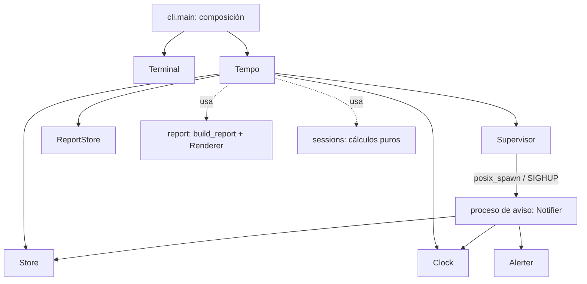

# Arquitectura



## Capas

| Capa | Módulos | Responsabilidad |
|---|---|---|
| Presentación | `cli.py`, `terminal.py`, `__main__.py` | Argumentos, preguntas interactivas, mensajes y códigos de salida |
| Dominio | `core.py`, `models.py`, `result.py` | Reglas de negocio expuestas como la API `Tempo` |
| Cálculo puro | `sessions.py`, `durations.py`, `report.py` | Tiempo trabajado, vencimiento, armado y formato de reportes |
| Infraestructura | `db.py`, `store_files.py`, `clock.py`, `supervisor.py`, `alerts.py`, `notifier.py`, `config.py` | SQLite, archivos, reloj, procesos, notificaciones |

Las dependencias van hacia abajo. `Tempo` no conoce `Terminal`: nunca pregunta ni imprime. Las decisiones del usuario llegan como parámetros obligatorios (`archive_client(id, *, cascade)`, `unarchive_project(id, *, with_client)`), y es la CLI la que consulta, pregunta y después llama con la decisión tomada.

`sessions.py` y `durations.py` son funciones puras a propósito: no tienen efectos externos que reemplazar, así que una interfaz no aportaría nada. `report.py` separa `build_report` (puro, produce el dato `Report`) de los `Renderer`, que solo dan formato.

## Composición

`cli.main(argv, deps=None)` es el único lugar que conoce las implementaciones reales. Sin `deps`, lee `Config` del entorno y arma:

```python
Tempo(
    SqliteStore(config.db_path),
    SystemClock(),
    ProcessSupervisor(...),
    saved_reports=DiskReportStore(config.reports_dir),
    loose_reports=DiskReportStore(Path.cwd()),
)
```

Los tests pasan un `Deps` con `DummyTerminal` y un `Tempo` construido sobre fakes. El subcomando interno `tempo notifier` no pasa por `Deps`: arma su propio `Notifier` en `serve_notifier`.

Cada pieza recibe solo el valor que necesita (`SqliteStore` recibe una ruta, no el `Config`).

## Interfaces

Todas son `typing.Protocol` con firmas y `...`, sin implementación. Las clases concretas las declaran explícitamente:

```python
class Clock(Protocol):
    def now(self) -> datetime: ...
    def wait(self, event: threading.Event, seconds: float | None) -> bool: ...

class SystemClock(Clock): ...
```

Declararlas hace que `mypy` marque una implementación incompleta (`Cannot instantiate abstract class ... with abstract attribute "wait"`). No hay herencia de código entre clases.

En protocolos que implementan dataclasses, los datos se declaran como atributos (`start: datetime`) y no como `@property`: `@dataclass` busca los defaults con `getattr` sobre la clase, encuentra la `property` heredada y la toma como valor por defecto del campo. Ver `Span` en `sessions.py`.

El detalle de cada interfaz está en [api/](api/).

## Errores como valores

```python
@dataclass(frozen=True, slots=True)
class Ok(Generic[T]):
    value: T

@dataclass(frozen=True, slots=True)
class Err(Generic[E]):
    error: E

type Result[V, F] = Ok[V] | Err[F]
```

Cada falla esperable es una dataclass inmutable en `result.py` (`MonthLocked(month)`, `ClientHasActiveProjects(projects)`, …) y cada operación declara en su tipo cuáles puede devolver:

```python
def start(self, project_id: int, duration_s: int, description: str
          ) -> Result[ActiveStatus, SessionAlreadyActive | ProjectNotFound | ProjectArchived]
```

`DomainError` es la unión de todas. La CLI las traduce a texto en `message()`, un `match` que termina en `assert_never`: una falla nueva sin mensaje es un error de `mypy`.

Reglas:

- Las excepciones de la stdlib se convierten en `Err` solo en el borde: `IntegrityError` de la regla `one_active` pasa a `SessionAlreadyActive`, `FileExistsError` a `FileExists`, un `ValueError` de `strptime` a `InvalidDate`.
- Una excepción que no corresponde a una falla esperable se vuelve a lanzar.
- `Tempo` valida todo antes de escribir, de modo que una operación nunca deja escrituras a medias que haya que deshacer. La validación corre dentro de la misma transacción que la escritura (`@atomic_write`), así que no puede quedar desactualizada por otro proceso.
- No hay resultados parciales: una falla siempre es un `Err` con el motivo.
- Las únicas excepciones atrapadas fuera del borde son `KeyboardInterrupt` y `EOFError` en `cli.entry()`, que muestran "Cancelado." y salen con 130.

En una función con varios `match` sobre resultados distintos hay que declarar `error: DomainError` al inicio: `mypy` fija el tipo de una variable de captura en el primer `case Err(error)` y rechaza los siguientes.

## Archivos de datos

```
~/.local/tempo/            # o $TEMPO_HOME
├── tempo.db               # SQLite (WAL: además tempo.db-wal y tempo.db-shm)
├── notifier.pid           # PID del proceso de aviso
├── notifier.lock          # flock para no lanzar dos procesos de aviso
├── notifier.log           # stdout/stderr del proceso de aviso
└── reports/               # reportes guardados: tempo-AAAA-MM.csv|md
```

`TEMPO_NO_NOTIFY=1` reemplaza el alerter por `NullAlerter`. Son las dos únicas variables de entorno que se leen, y se leen una sola vez en `Config.from_env`.
