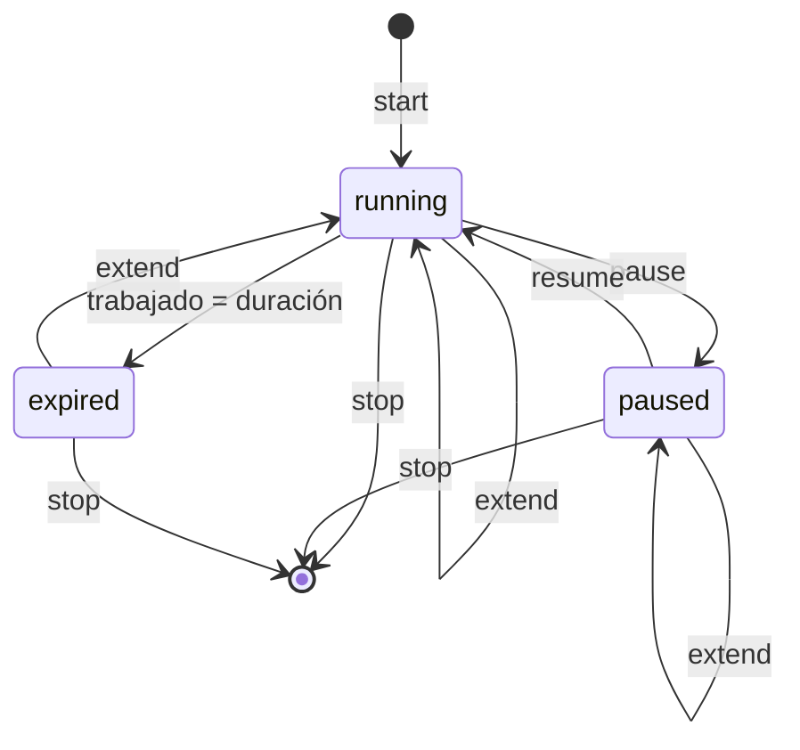

# Sesiones

Una sesión es una fila de `sessions` (proyecto, descripción, `start_at`, `duration_s`, `end_at`) más sus filas de `pauses`. `duration_s` es la duración **planificada**; el tiempo trabajado nunca se guarda, se deriva. `end_at IS NULL` significa sesión abierta, y el índice parcial `one_active` garantiza que haya como máximo una.

## Modelo de tiempo

Todos los cálculos están en `sessions.py`, son puros y operan sobre cualquier secuencia de `Span` (`start: datetime`, `end: datetime | None`).

**Precisión.** Los timestamps se guardan con resolución de segundos (`isoformat(timespec="seconds")`, en UTC); la fracción se descarta al escribir. Los intervalos se convierten a segundos enteros truncando (`int(timedelta.total_seconds())`). En pantalla, los tiempos trabajados se muestran truncados al minuto (`format_hm`) y el tiempo restante redondeado hacia arriba (`format_hm_up`), para que 59 segundos restantes no se lean como `0:00`.

### Tiempo pausado y trabajado

```
pausado(t)   = Σ max(0, min(fin_p, t) - inicio_p)     fin_p = t si la pausa está abierta
trabajado(t) = (t - inicio) - pausado(t)              0 si t <= inicio
```

Las pausas no se fusionan: si dos se superpusieran, el solapamiento se descontaría dos veces. La API no puede producir pausas superpuestas (a lo sumo una abierta por sesión, y `edit` las recorta sin crear nuevas).

### Vencimiento

```python
def expiry_time(start, duration_s, pauses) -> datetime | None
```

Recorre las pausas ordenadas por inicio con un cursor `moment` (arranca en `start`) y un `remaining` (arranca en `duration_s`):

1. Si la pausa empieza antes de `moment` (solapada con un tramo ya descontado): si está abierta devuelve `None`; si no, avanza `moment` hasta su fin y sigue.
2. Si `moment + remaining <= inicio de la pausa`, el tiempo se agota antes de pausar: devuelve `moment + remaining`.
3. Si no, descuenta `inicio_pausa - moment` de `remaining`. Si la pausa está abierta devuelve `None`; si no, `moment` pasa al fin de la pausa.

Al terminar las pausas devuelve `moment + remaining`. Consecuencias: una pausa posterior al vencimiento no lo mueve, y mientras haya una pausa abierta antes de vencer el vencimiento es indeterminado.

### Estado

`session_state(start, duration_s, pauses, now)` devuelve `SessionState(kind, worked_s, remaining_s, expires_at, paused_since)`:

| `kind` | Condición, evaluada en este orden | `worked_s` | `expires_at` | `paused_since` |
|---|---|---|---|---|
| `expired` | `expiry_time` no es `None` y `<= now` | `duration_s` exacto | el vencimiento | `None` |
| `paused` | hay una pausa con `end = None` | `trabajado(now)` | `None` | inicio de esa pausa |
| `running` | resto | `trabajado(now)` | el vencimiento | `None` |

`remaining_s = duration_s - worked_s`. Una sesión vencida queda detenida: su tiempo trabajado es la duración planificada aunque nadie haya hecho `stop`.

`effective_end(start, duration_s, pauses, now)` es el fin que se registra al cerrar: el vencimiento si ya pasó, `now` en otro caso.



## Operaciones sobre la sesión activa

Todas siguen el mismo patrón, dentro de una única transacción `BEGIN IMMEDIATE` (`@atomic_write`): leer el estado con `store.active_session()` y `session_state`, validar, escribir y releer el resultado. Después del `COMMIT`, y solo si el resultado es `Ok`, se llama a `supervisor.sync()`. Las validaciones se evalúan en el orden en que aparecen en las tablas.

### `start(project_id, duration_s, description) -> Result[ActiveStatus, StartError]`

| Falla | Condición |
|---|---|
| `ProjectNotFound(str(project_id))` | el proyecto no existe |
| `ProjectArchived(nombre)` | el proyecto está archivado |
| `EmptyDescription()` | la descripción queda vacía después de `strip()` |
| `SessionAlreadyActive(id_activa)` | el `INSERT` viola `one_active` |

Escribe `start_at = clock.now()` y `description.strip()`. La sesión activa se detecta en el `INSERT` y no antes: `SqliteStore.add_session` traduce el `IntegrityError` de `one_active`. `duration_s` debe ser positiva (`CHECK (duration_s > 0)`); la CLI lo garantiza con `durations.parse`.

### `pause() -> Result[ActiveStatus, PauseError]`

| Falla | Condición |
|---|---|
| `NoActiveSession` | no hay sesión abierta |
| `SessionExpired(expires_at)` | ya venció |
| `AlreadyPaused(paused_since)` | ya está pausada |

Inserta una pausa con `start_at = now` y `end_at = NULL`.

### `resume() -> Result[ActiveStatus, NoActiveSession | NotPaused]`

Cierra la pausa abierta con `end_at = now` (`UPDATE ... WHERE end_at IS NULL`).

### `extend(seconds) -> Result[ActiveStatus, NoActiveSession]`

Válido en cualquier estado. En una transacción:

1. Si la sesión venció, inserta la pausa cerrada `[expires_at, now]`.
2. `duration_s += seconds`.

El paso 1 hace que el tiempo entre el vencimiento y la respuesta del usuario no cuente, y que la sesión se reanude desde el `extend`:

```
10:00  start 1h          vence 11:00
11:00  vence             trabajado 1:00, contador detenido
11:40  extend 30m        pausa [11:00, 11:40]; duración 1:30; vence 12:10
12:10  vence             trabajado 1:30, pausas 0:40
```

Sobre una sesión pausada solo suma duración; el vencimiento se vuelve a calcular al reanudar. `seconds` no se valida en `Tempo`: un valor que deje `duration_s <= 0` viola el `CHECK` y termina con `IntegrityError`.

### `stop(description) -> Result[Session, NoActiveSession | EmptyDescription]`

1. `end = effective_end(...)`: ahora, o el vencimiento si ya pasó. Una sesión de 1 h iniciada a las 10:00 y detenida a las 11:40 queda registrada de 10:00 a 11:00.
2. Si está pausada, cierra la pausa en `end` (que en ese caso es `now`: una sesión pausada no puede estar vencida).
3. `end_at = end`; la descripción se conserva si `description is None` y se reemplaza por `description.strip()` en otro caso, que no puede quedar vacía (`EmptyDescription`).

La CLI pasa siempre `None`: `tempo stop` no pregunta y cierra con la descripción cargada en `start`.

### Concurrencia

La validación y la escritura de cada operación corren en una sola transacción `BEGIN IMMEDIATE` (`@atomic_write`), así que dos comandos simultáneos sobre la misma sesión se serializan: el segundo espera el lock y valida contra el estado que dejó el primero. El detalle, la tabla de carreras y el riesgo aceptado en `edit` están en [persistencia](api/persistencia.md#concurrencia).

## Sesiones cerradas

### `edit_session(id, *, project_id, description, start_at, end_at) -> Result[Session, EditError]`

| Falla | Condición |
|---|---|
| `SessionNotFound(id)` | no existe |
| `SessionIsActive(id)` | está abierta; se maneja con `pause`, `extend` y `stop` |
| `MonthLocked(mes)` | el mes local del inicio original está bloqueado; después, el del inicio nuevo |
| `InvalidInterval(start, end)` | `end_at <= start_at` |
| `ProjectNotFound(str(project_id))` | el proyecto no existe (archivado está permitido) |
| `EmptyDescription()` | la descripción queda vacía después de `strip()` |

En una transacción reemplaza proyecto, descripción, inicio y fin, y reescribe las pausas recortadas al intervalo nuevo:

```
pausa' = [max(inicio_p, start_at), min(fin_p, end_at)]   para toda pausa con fin_p > start_at y inicio_p < end_at
```

Las que quedan afuera se descartan. `duration_s` no cambia: es la duración planificada.

La CLI verifica el bloqueo del mes antes de preguntar, elige el proyecto con la lista de `start` (con `Mantener` como primera opción) y pide los demás campos con el valor actual como default (fechas `AAAA-MM-DD HH:MM`, hora local). Valida cada respuesta al ingresarla: descripción no vacía, fecha bien escrita, inicio en un mes no bloqueado y fin posterior al inicio. Si otro proceso modifica la sesión mientras la persona responde, la edición lo pisa: es un [riesgo aceptado](api/persistencia.md#riesgo-aceptado-edición-concurrente).

### `delete_session(id) -> Result[None, SessionNotFound | MonthLocked]`

Borra la sesión; sus pausas caen por `ON DELETE CASCADE`. El bloqueo se evalúa sobre el mes local del inicio. No distingue sesiones abiertas: borrar la activa la descarta. La CLI muestra la sesión en una tabla con encabezados y pide confirmación (default: no).

## Proyectos, clientes y archivado

Un proyecto tiene nombre único, descripción y un cliente opcional (`client_id NULL`). El cliente se fija al crear el proyecto: el trigger `project_client_immutable` aborta cualquier `UPDATE` de `client_id`, y la API no ofrece la operación. Los nombres se normalizan con `strip()`; vacíos dan `InvalidName`, repetidos `ProjectNameTaken` o `ClientNameTaken`. La unicidad distingue mayúsculas (`COLLATE BINARY`).

Renombrar clientes y proyectos está permitido aunque aparezcan en meses exportados: el bloqueo protege las horas, no los nombres. Un re-export muestra el nombre nuevo.

Archivar oculta de las listas de selección (`start`, elección de cliente al crear un proyecto, `project list` y `client list` sin `--archived`). Las sesiones siguen en `list` y en los reportes, y una sesión abierta de un proyecto archivado sigue su curso hasta el `stop`.

| Operación | Validación | Efecto |
|---|---|---|
| `archive_project(id)` | `ProjectNotFound`; `ProjectArchived` si ya está archivado | marca el proyecto |
| `archive_client(id, cascade=False)` | `ClientNotFound`; `ClientArchived` si ya está archivado; `ClientHasActiveProjects(nombres)` si tiene proyectos activos | marca el cliente |
| `archive_client(id, cascade=True)` | `ClientNotFound`; `ClientArchived` | en una transacción archiva sus proyectos activos y el cliente; devuelve los proyectos afectados |
| `unarchive_client(id)` | `ClientNotFound`; `ClientNotArchived` si está activo | desarchiva solo el cliente |
| `unarchive_project(id, with_client=False)` | `ProjectNotFound`; `ProjectNotArchived` si está activo; `ClientArchived(nombre)` si el cliente está archivado | desarchiva el proyecto |
| `unarchive_project(id, with_client=True)` | `ProjectNotFound`; `ProjectNotArchived` | desarchiva cliente y proyecto en una transacción |
| `add_project(nombre, client_id, desc)` | `InvalidName`; `ClientNotFound`; `ClientArchived`; `ProjectNameTaken` | crea el proyecto |

`unarchive_client` no desarchiva proyectos porque no hay registro de cuáles se archivaron en cascada y cuáles ya estaban archivados.

La CLI consulta antes de decidir: `client archive` lista los proyectos activos y llama con `cascade=True` solo si se confirma; `project unarchive` y `start` (al elegir un proyecto archivado por nombre) preguntan si desarchivar también el cliente. En `start`, escribir el nombre de un cliente archivado al crear un proyecto ofrece desarchivarlo; responder que no cancela.
